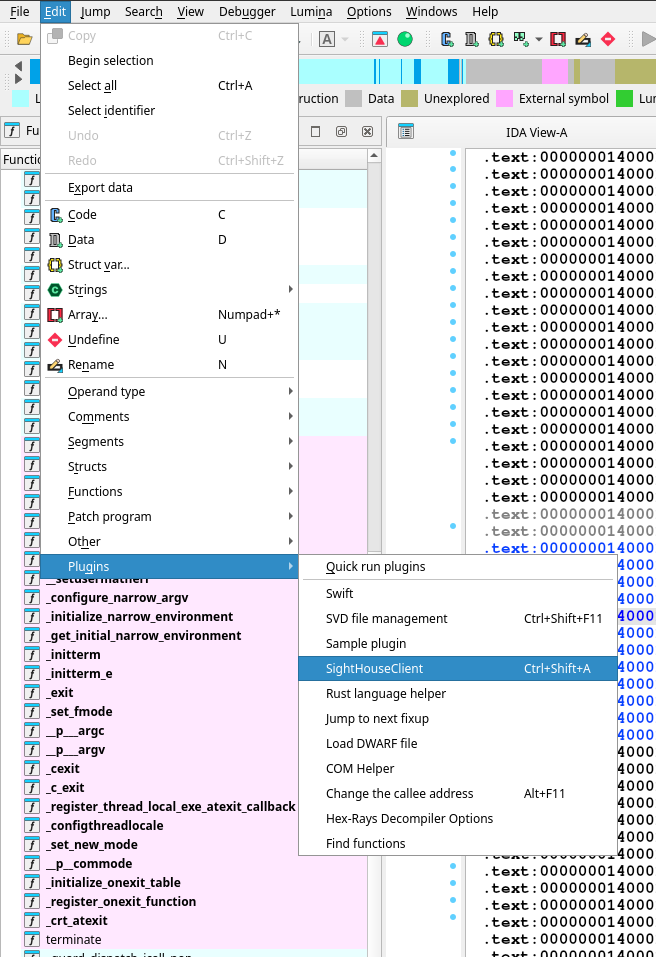
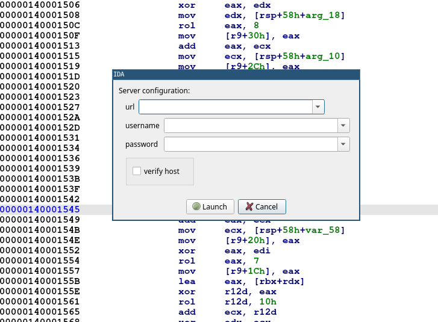
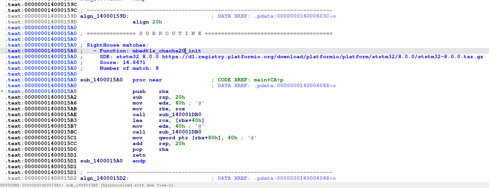

# IDA

<div markdown="span" style="float:right;margin-left:20px;margin-top:-90px;">

  { width="120" }

</div>

## Installation

IDA does not use a virtual environment: IDAPython runs on the Python interpreter
selected with IDA's `idapyswitch` tool. The plugin needs the `sighthouse-client`
package installed **in that interpreter**, so the installer:

1. reads the Python library IDA is configured to load (`Python3TargetDLL` in
   `~/.idapro/ida.reg` on macOS/Linux, or `HKCU\Software\Hex-Rays\IDA` on Windows),
2. runs `pip install --upgrade sighthouse.client` with the matching interpreter,
3. copies `SightHouseClientIDA.py` to your IDA user plugins directory
   (`$IDAUSR/plugins`, `~/.idapro/plugins` or `%APPDATA%\Hex-Rays\IDA Pro\plugins`).

If you have never run `idapyswitch`, run it once first (it lives next to the IDA
binary, e.g. `/Applications/IDA Professional 9.x.app/Contents/MacOS/idapyswitch`).

The easiest way to install the IDA plugin is to install the `sighthouse-client`
package and then run:

```bash
pip install sighthouse-client
sighthouse client install ida
```

It's also possible to install it from the repository:

```bash
git clone https://github.com/quarkslab/sighthouse
cd sighthouse/sighthouse-client
make install_ida
```

Useful options (also accepted by `python src/sighthouse/client/install_ida.py`):

| Option | Description |
| --- | --- |
| `--dry-run` | Show which interpreter and plugins directory would be used, without changing anything. |
| `--python PATH` | Use this interpreter instead of the one detected from the `idapyswitch` settings. |
| `--break-system-packages` | Allow installing into an externally managed Python (PEP 668, e.g. Homebrew or Debian's system Python). Pointing IDA at a non-managed Python with `idapyswitch` is usually a better fix. |
| `--ida-dir PATH` | IDA installation directory. Optional (also read from `$IDA_DIR`); only used as a sanity check. |

!!! note
    Activating a virtual environment before running the installer has no effect on IDA:
    packages installed there are not visible to IDAPython unless IDA itself loads that
    environment's Python library.


## Usage

After restarting IDA, go under *Edit* -> *Plugins* and run the SightHouse Client Plugin. 

<figure markdown="span">
  { height="512" }
  <figcaption>SightHouse Plugin Entry</figcaption>
</figure>

Upon running, you should get a prompt asking for credentials and server endpoint like this one:

<figure markdown="span">
  { height="512" }
  <figcaption>SightHouse Plugin</figcaption>
</figure>

Once the plugin finished running, the matches are available as comment and should look something similar to 
this:

<figure markdown="span">
  { width="614" }
  <figcaption>SightHouse Matches</figcaption>
</figure>
